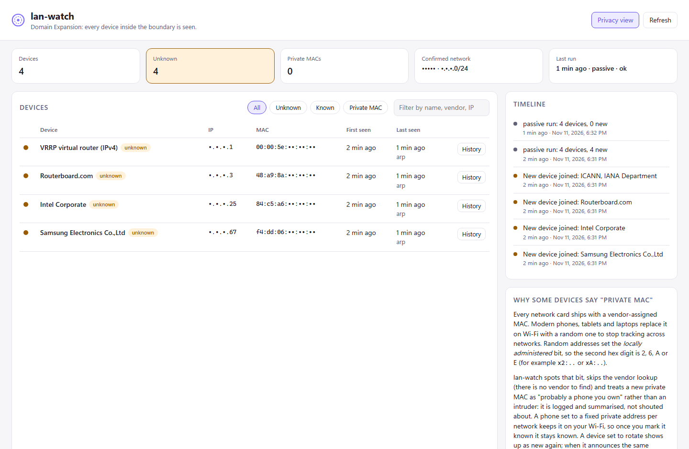

# lan-watch

*Domain Expansion: every device inside the boundary is seen.*

lan-watch keeps an inventory of every device on one home network and raises a Windows toast when an unknown device joins. It is passive first, it refuses to touch any network you have not confirmed, and the runtime has no third-party dependencies: Python 3.12 standard library plus tools that ship with Windows.



## What it does

- **Inventory in SQLite**: MAC, IP history, vendor (offline IEEE OUI lookup, longest prefix across MA-L, MA-M and MA-S), hostname (DHCP option 12, mDNS, NetBIOS, or router PTR), first/last seen, your label and a "known" flag.
- **Detections**
  - new device (vendor MAC): toast
  - new device on a private (randomised) MAC: logged and summarised in one low-key toast instead of an "intruder" alert (see below)
  - private-MAC rotation: a new random MAC announcing the hostname of a device you already have is linked to it in the timeline, but never trusted automatically, because hostnames are spoofable
  - IP conflict: two MACs claiming one IP in the same run, or an IP changing hands within 30 minutes while the previous holder vanished
  - gateway ARP change: the router's IP resolving to a different MAC than the one confirmed, or the router's MAC also answering for another IP (the classic ARP-spoofing signature). Critical toast, and active probing pauses until you re-confirm
- **Dashboard** on `http://127.0.0.1:8765/`: device list with filters, IP history, timeline, *Mark as known*, labels, and a privacy view that masks MACs, IPs and names server-side for screenshots.
- **Schedule**: a battery-safe Windows scheduled task, registered and removed by one script.

## The safety model

This laptop sometimes runs a corporate VPN and DNS-filtering client. lan-watch is built so that pointing it at anything other than the home LAN is impossible, not merely discouraged.

1. **One human confirmation.** `lanwatch confirm` reads the interface carrying the default route and shows its subnet, gateway, gateway MAC and Windows network profile. You confirm by *typing the subnet*. It refuses outright if a VPN or tunnel adapter is up, if the subnet is not RFC 1918, or if it is larger than a /22 (1022 hosts: a home, never a corporate range). The confirmation lives in `%LOCALAPPDATA%\lan-watch`, outside the repo, and is re-validated on every load, so a hand-edited file cannot widen it.
2. **Every run re-checks before reading anything.** Interface, subnet, gateway and profile name must match the confirmation, the default route must be on that interface and no VPN adapter may be up. If anything differs (office, café, VPN connected), the run records a "skipped" entry and stops *before* reading the neighbor table, so nothing from another network is ever stored.
3. **Passive by default.** A default run sends no packets. It reads the Windows neighbor (ARP) cache and, with `--listen N`, listens for mDNS, SSDP, DHCP and NetBIOS broadcasts.
4. **Active is opt-in twice and structurally fenced.** Active discovery needs `allow_active` at confirmation *and* `--active` on the run, and it pauses automatically if the gateway MAC has changed. Probes in `active.py` cannot be called without an `ActiveAuthorization`, which only `safety.authorize_active()` can create, and every probe passes each target through `check_target()`: RFC 1918, inside the confirmed subnet, not the network or broadcast address, not this machine.
5. **Gentle when active.** The ARP sweep uses Windows' own `SendARP` (no Npcap, no admin), rate-limited to 10 requests per second. NetBIOS node-status queries go only to devices already found. PTR lookups go only to the confirmed gateway, and only when it is the interface's DNS server, so private IPs never leak to an outside resolver.
6. **No port scanning**, except `lanwatch ports <ip>`: an opt-in TCP connect check of nmap's top 20 ports on one device, one port at a time, behind a prompt and the same target check.
7. **Untrusted input stays data.** Hostnames and SSDP banners come from other devices. Parsers are bounds-checked (compression-pointer loops, truncation), names are stripped of control characters and capped, the dashboard renders with `textContent` only, and toast text is XML-escaped and passed to a fixed PowerShell script through an environment variable.
8. **The dashboard is local.** It binds to `127.0.0.1` with no option to change that, rejects any Host header other than `127.0.0.1:<port>` / `localhost:<port>` (DNS rebinding), requires a per-process CSRF token plus JSON plus a same-origin `Origin` for changes, and sends a strict Content-Security-Policy.

### Why phones are not flagged as intruders every day

A MAC whose first octet has the *locally administered* bit set (second hex digit 2, 6, A or E) was not assigned by a manufacturer. Phones, tablets and laptops use such random addresses on Wi-Fi for privacy. lan-watch detects the bit, skips the vendor lookup (there is no vendor to find), tags the device "private MAC" and batches new ones into a single informational toast. Marking it known sticks for as long as the device keeps that address on your network. The explanation also lives in the dashboard.

### Npcap and nmap

Not required and not installed. Everything above works with what Windows ships: `Get-NetNeighbor`, `iphlpapi.dll!SendARP`, ordinary UDP sockets and the WinRT toast API in PowerShell 5.1. Passive listeners only receive packets that Windows Defender Firewall lets through; Windows may ask whether Python can receive on private networks the first time you use `--listen`, and declining simply means the listeners hear less.

## Setup

```powershell
py -3.12 -m venv .venv
.venv\Scripts\python -m pip install setuptools
.venv\Scripts\python -m pip install --no-build-isolation -e ".[dev]"
.venv\Scripts\python -m lanwatch update-oui     # ~6 MB of IEEE CSVs into %LOCALAPPDATA%\lan-watch
```

## Use

```powershell
.venv\Scripts\python -m lanwatch status          # live network + what the gate allows (sends nothing)
.venv\Scripts\python -m lanwatch confirm         # one-time: type the subnet to confirm home
.venv\Scripts\python -m lanwatch run             # passive inventory
.venv\Scripts\python -m lanwatch run --listen 30 # + listen for broadcasts for 30 s
.venv\Scripts\python -m lanwatch run --active    # + rate-limited ARP sweep (needs allow-active)
.venv\Scripts\python -m lanwatch serve --open    # dashboard on 127.0.0.1:8765
.venv\Scripts\python -m lanwatch known aa:bb:cc:dd:ee:ff
.venv\Scripts\python -m lanwatch ports 192.168.1.20   # opt-in, one device, top-20 TCP
```

Schedule it (per-user, no elevation, runs on battery, never overlaps, 5-minute limit):

```powershell
.\scripts\Register-LanWatchTask.ps1                  # every 15 minutes, passive
.\scripts\Register-LanWatchTask.ps1 -Unregister
```

## Tests

```powershell
.venv\Scripts\python -m pytest
```

Fixtures in `tests/fixtures` are synthetic and use example addresses only: Windows `arp -a` and `Get-NetNeighbor` output, `Get-NetAdapter`-style snapshots (home, and with a VPN up), and byte-exact wire-format mDNS, DHCP, NetBIOS, PTR and SSDP packets built with `struct` by `make_packets.py`, including malformed ones. Nothing from a real network is committed.

## Layout

| Path | Role |
| --- | --- |
| `src/lanwatch/safety.py` | confirmation, gate, `ActiveAuthorization`, target checks |
| `src/lanwatch/netinfo.py` + `ps/*.ps1` | read-only interface snapshot and neighbor table |
| `src/lanwatch/listen.py`, `packets/` | passive listeners and parsers |
| `src/lanwatch/active.py` | ARP sweep, NetBIOS/PTR names, opt-in port check |
| `src/lanwatch/detect.py` | inventory updates, detections, alerts |
| `src/lanwatch/db.py` | SQLite schema |
| `src/lanwatch/web.py`, `static/` | dashboard |
| `src/lanwatch/notify.py` | Windows toasts |
| `scripts/Register-LanWatchTask.ps1` | scheduled task |

## Why Python and the standard library

The work is parsing (ARP tables, DNS, DHCP, NetBIOS), SQLite and a small HTTP server: all in the Python standard library, which keeps the trusted code base to what is in this repo plus CPython and Windows. `ctypes` reaches `SendARP` directly, so no packet-capture driver is needed. A stdlib `http.server` bound to loopback is enough for a single-user dashboard and leaves no framework defaults to audit.
